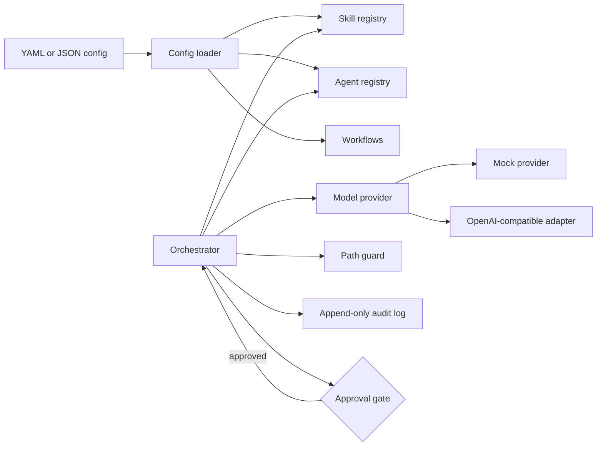

<!--
SPDX-License-Identifier: Apache-2.0
Copyright 2026 Krishna Das
See NOTICE at the repository root.
-->

# AI-DLC agents

A team asked a chat window for a service and got a pile of files nobody had agreed to. The intent was still a sentence, the domain was a guess, and the diff landed with no record of who accepted it. This module is the lifecycle I put in front of that work. You describe the skills and the agents that fit the business, and a workflow runs them through the AI-DLC phases: inception, construction and operations. A person approves the gate between phases. Every step is appended to an audit log.

The default model provider is an offline mock. The demo and the tests need no API key. An OpenAI-compatible HTTP adapter is there for a real endpoint, configured with environment variables.



Inception turns an intent into units of work. Construction designs the domain and writes code and tests. Operations reviews what was written. The run pauses at a gate and does not enter the next phase until a person approves it.

## Setup

From this directory, with Node.js 20 or newer:

```bash
pnpm demo
```

That runs the NestJS CRUD workflow with the mock provider. It prints each phase, records an approval at every open gate as `demo`, writes the files under `output/nestjs-crud/<run-id>/` and appends `output/audit.jsonl`. `--hold` stops at the first gate instead of approving it. `--profile regulated` asks for a person after operations as well.

The API and the small page:

```bash
pnpm dev
```

Open http://127.0.0.1:3000. Start a run, then approve or reject before the next phase. `GET /api/runs`, `POST /api/runs`, `POST /api/runs/:id/approvals` and `GET /api/audit` are the same calls the page makes.

From the repository root:

```bash
pnpm install
pnpm --filter @krishnadas/ai-dlc-agents demo
pnpm --filter @krishnadas/ai-dlc-agents dev
```

Docker, from this directory:

```bash
docker compose up --build
```

Open http://localhost:3000. The container uses the mock provider, so it does not need a key. Copy `.env.example` to `.env` in this directory when you want a different profile, output directory or HTTP endpoint. Values already set in the environment win over the file.

Tests, from the repository root:

```bash
pnpm --filter @krishnadas/ai-dlc-agents test
```

Stop the demo with `docker compose down` from this directory.

## Usage

The package name is `@krishnadas/ai-dlc-agents`. It is a private workspace package, so it is not on a public registry. In another package in this repository, depend on it and install from the root:

```json
{
  "dependencies": {
    "@krishnadas/ai-dlc-agents": "workspace:*"
  }
}
```

```bash
pnpm install
```

Node.js 20 or newer. The export map points at `src/index.ts`, so the project that imports it has to compile that TypeScript. The demo uses `tsx`.

To use the module in a different repository, copy `modules/ai-dlc-agents` and point the dependency at that folder (`workspace:*` or `file:`). Keep the license header on the copied files, and keep the repository [LICENSE](../../LICENSE) and [NOTICE](../../NOTICE) with the copy.

Import from `@krishnadas/ai-dlc-agents`. `defineKitConfig` merges a document onto the defaults and checks it with zod. Nested `provider` and `health` merge field by field. A `profiles` entry replaces that profile. `skills`, `agents` and `workflows` replace the default lists when you set them. `loadKitConfig({ path, env })` reads a `.yaml`, `.yml` or `.json` file, then applies the environment. When `env` is omitted it reads `process.env`, and a `.env` file in the working directory when one is present. Values already set in the environment win over that file.

`LifecycleModule.register({ config, provider?, env? })` mounts the run, approval and audit routes, and the health paths from the config. Leave `provider` unset and each agent uses its own provider. `DLC_PROVIDER` forces every agent onto one kind for the process. Pass `provider: new MockProvider()` when a test or the demo must stay offline even if that variable is set.

The example document is `examples/nestjs-crud.yaml`. It defines five skills (`requirements-to-stories`, `domain-model`, `generate-nest-module`, `generate-tests`, `review-diff`), three agents (`analyst`, `builder`, `reviewer`) and one workflow (`nestjs-crud`). The builder may write under `src/` and `test/`. The reviewer may write under `docs/`. A path outside those prefixes, or a path that climbs out of the run directory, fails the run and writes nothing.

```ts
import { Module } from "@nestjs/common";
import { NestFactory } from "@nestjs/core";
import {
  LifecycleModule,
  MockProvider,
  WorkflowOrchestrator,
  defineKitConfig,
  loadKitConfig,
} from "@krishnadas/ai-dlc-agents";

const kitConfig = loadKitConfig({ path: "examples/nestjs-crud.yaml" });

@Module({
  imports: [LifecycleModule.register({ config: kitConfig })],
})
export class AppModule {}

const app = await NestFactory.create(AppModule, { logger: false });
app.enableShutdownHooks();
await app.listen(3000);
```

The same orchestrator runs without HTTP. This config is the smaller notes workflow. The mock has no special case for `write-note`, so each phase records the skill name and the intent and writes no files. The gates still pause the run.

```ts
import { MockProvider, WorkflowOrchestrator, defineKitConfig } from "@krishnadas/ai-dlc-agents";

const config = defineKitConfig({
  profile: "startup",
  outputRoot: "output",
  skills: [
    {
      name: "write-note",
      description: "Write a short note into the sandbox.",
      whenToUse: "When the run needs a note on disk.",
      inputSchema: {
        type: "object",
        required: ["intent", "prior"],
        properties: { intent: { type: "string" }, prior: { type: "object" } },
      },
      outputSchema: {
        type: "object",
        required: ["skill", "intent"],
        properties: { skill: { type: "string" }, intent: { type: "string" } },
      },
      promptTemplate: "Write a note for {{intent}}",
      allowedTools: ["write_file"],
    },
  ],
  agents: [
    {
      name: "scribe",
      role: "Scribe",
      provider: "mock",
      modelId: "mock-deterministic",
      systemPrompt: "You write notes inside the sandbox.",
      skills: ["write-note"],
      guardrails: { allowedPaths: ["docs"], maxTokens: 2000, maxSteps: 8 },
    },
  ],
  workflows: [
    {
      name: "notes",
      description: "Three phases that record a note.",
      outputDir: "notes",
      phases: [
        { phase: "inception", agent: "scribe", skills: ["write-note"], approvalGate: true },
        { phase: "construction", agent: "scribe", skills: ["write-note"], approvalGate: false },
        { phase: "operations", agent: "scribe", skills: ["write-note"], approvalGate: false },
      ],
    },
  ],
});

const orchestrator = new WorkflowOrchestrator({ config, provider: new MockProvider() });
let run = await orchestrator.start({
  workflow: "notes",
  intent: "Write the receiving notes for the desk",
  actor: "ada",
});
while (run.status === "awaiting_approval") {
  run = await orchestrator.approve(run.id, "ada");
}
```

`start` runs until the next gate or until the workflow finishes. `approve` records the person and continues. `reject` stops the run. A second decision on a run that is not waiting throws.

A workflow has to list inception, construction and operations, in that order. A phase skill has to be one of the skills assigned to that phase's agent. The `regulated` profile has to keep audit logging on and approval on every phase. Those checks fail at config load, not halfway through a run.

| Field | Type | Default | Meaning |
| --- | --- | --- | --- |
| `profile` | `string` | `startup` | Which profile a run uses when the caller does not pass one |
| `profiles.regulated.auditLogging` | `true` | `true` | Required. The regulated profile cannot turn the audit log off |
| `profiles.regulated.approval` | `"every-phase"` | `"every-phase"` | Required. A person approves every phase, including one whose own gate is off |
| `profiles.startup.auditLogging` | `boolean` | `true` | The lighter profile still logs unless you turn it off |
| `profiles.startup.approval` | `"every-phase" \| "as-configured"` | `"as-configured"` | `as-configured` stops only where `approvalGate` is true |
| `skills[].name` | `string` | none | Lowercase name. Referenced by agents and phases |
| `skills[].whenToUse` | `string` | none | When this skill is the right one |
| `skills[].inputSchema` / `outputSchema` | object schema | none | `type: object`, plus `required` and `properties`. Each property is `string`, `number`, `boolean`, `object` or `array` |
| `skills[].promptTemplate` | `string` | none | Must contain `{{intent}}`. `{{prior}}` is replaced with the artifacts so far |
| `skills[].allowedTools` | `write_file`, `read_file`, `list_files` | `[]` | A file write or a tool call outside this list fails the run |
| `agents[].role` | `string` | none | What the person is for |
| `agents[].provider` | `"mock" \| "openai-compatible"` | none | Used when `DLC_PROVIDER` is unset |
| `agents[].modelId` | `string` | none | Sent on the model request. `DLC_PROVIDER_MODEL` overrides it for the process |
| `agents[].skills` | `string[]` | none | Skills this agent is allowed to run |
| `agents[].guardrails.allowedPaths` | `string[]` | none | One path segment each, such as `src`. Writes must start with one of them |
| `agents[].guardrails.maxTokens` | `number` | none | A reply over this budget fails the phase |
| `agents[].guardrails.maxSteps` | `number` | none | Model calls, tool calls and file writes in one phase. The counter resets each phase |
| `workflows[].phases` | three phases | none | Inception, then construction, then operations |
| `workflows[].phases[].approvalGate` | `boolean` | none | Startup stops here when this is true. Regulated stops either way |
| `workflows[].outputDir` | `string` | none | Directory under `outputRoot`. Each run gets its own folder inside it |
| `provider.kind` | `"mock" \| "openai-compatible"` | `mock` | Process default. The demo forces the mock |
| `provider.modelId` | `string` | `mock-deterministic` | Default model id on the provider block |
| `provider.baseUrl` | `string` | `http://127.0.0.1:8080/v1` | Chat completions base URL, including `/v1` |
| `provider.apiKeyEnv` | `string` | `DLC_PROVIDER_API_KEY` | Name of the variable that holds the key. The key is not stored in the config |
| `provider.timeoutMs` | `number` | `30000` | HTTP timeout |
| `outputRoot` | `string` | `output` | Sandbox root. A relative path is resolved from the working directory |
| `health.livenessPath` | `string` | `/health/live` | Process is up |
| `health.readinessPath` | `string` | `/health/ready` | Process is up. The mock provider has no dependency to ping |

Environment variables: `DLC_PROFILE`, `DLC_PROVIDER`, `DLC_PROVIDER_BASE_URL`, `DLC_MODEL`, `DLC_PROVIDER_API_KEY_ENV`, `DLC_PROVIDER_API_KEY`, `DLC_PROVIDER_TIMEOUT_MS`, `DLC_PROVIDER_MODEL`, `DLC_OUTPUT_ROOT`, `DLC_LIVENESS_PATH`, `DLC_READINESS_PATH`, `DLC_CONFIG`. `PORT` selects the API port and defaults to 3000.

`POST /api/runs` takes `{ workflow, intent, actor?, profile? }`. `POST /api/runs/:id/approvals` takes `{ actor, decision: "approve" | "reject", comment? }`. `GET /api/audit` returns the append-only log for this process. Those routes belong to `LifecycleModule`. `GET /` is the demo page, not part of the module.

The audit entry is `{ seq, at, actor, action, runId, workflow, phase?, skill?, inputHash, outputHash }`. `actor` is who did it: the person who started or approved, or the agent that ran a skill. `action` is what happened (`run.start`, `phase.start`, `skill.invoke`, `file.write`, `tool.list_files`, `tool.read_file`, `phase.awaiting_approval`, `phase.approved`, `phase.rejected`, `phase.completed`, `run.completed`, `run.failed`). `at` is when. The hashes are SHA-256 of the input and the output. The log has no update and no delete.

## Design

The phases are fixed. Inception, construction, operations, in that order. A workflow that skips one is a different process, and I did not want a config that looks like AI-DLC and then quietly drops the review. The check is in the schema, so a bad file fails before a run starts.

The gate is a pause, not a flag on the side. `start` and `approve` return when the run is waiting. The next phase does not run in the same call. Regulated means every phase, including one marked `approvalGate: false`. Startup means the flags on the workflow. I locked the regulated profile in the schema. A file that sets `auditLogging: false` on it, or that sets its approval to `as-configured`, does not load. The startup profile is the lighter one: it can turn the log off, and it can leave a phase without a gate. The example leaves the gate off for operations, so a startup run reviews and finishes after construction is approved. A regulated run stops again after that review.

The audit log stores hashes rather than a second copy of the payload that a caller could edit. The entry is frozen, and `list` returns a copy. A file sink, when you pass one, only appends a JSON line. The CLI writes `output/audit.jsonl` that way. The API keeps the log in the process and returns it from `GET /api/audit`. I did not add an update method. A profile with `auditLogging: false` records nothing. Regulated cannot select that.

The path guard is the sandbox. An agent's `allowedPaths` are prefixes (`src`, `test`, `docs`), and the resolved path has to stay under that run's directory. `..`, an absolute path and a prefix the agent was not given fail the run before the write. The skill also has to list `write_file` or the files are refused. `read_file` and `list_files` go through the same check. The mock review calls `list_files` and then writes `docs/review.md`. It does not pretend to be a person. The gate is the decision.

The mock provider is deterministic. The same skill and the same input return the same text, and it never opens a socket. For the five skills in the example it builds a real NestJS CRUD module from the noun in the intent (`for library books` becomes `Book`), plus a service test and a review note. Any other skill name gets a small JSON artifact with the skill and the intent, which is what the notes sample above relies on. The HTTP adapter posts to `{baseUrl}/chat/completions` with `temperature: 0` and the agent's model id. The key is read from the environment at call time and is not written into the audit log. If the key is missing, the call fails before the request. `DLC_PROVIDER=mock` forces every agent onto the mock, which is how a machine without a key stays offline.

Step and token budgets are per phase. The counter resets when the phase changes, so construction can spend more than inception. A reply that does not fit `maxTokens`, or a phase that would take more than `maxSteps`, fails the run and appends `run.failed` when the profile is logging.

## Credit / attribution

This module is authored by Krishna Das ([github.com/kr1shnadas](https://github.com/kr1shnadas)).

Anyone who uses it must give credit to Krishna Das. That covers calling it from your own service and shipping a copy or a derivative. Keep the Apache-2.0 license header on the source files (`SPDX-License-Identifier: Apache-2.0` and `Copyright 2026 Krishna Das`). Keep the repository [LICENSE](../../LICENSE) and [NOTICE](../../NOTICE) intact. Section 4(d) of the Apache License 2.0 is why the NOTICE stays: a redistribution or a derivative work has to retain that file and give visible credit to Krishna Das, in the source, in the documentation that goes with it, or on a display the work normally shows.

The license remains Apache-2.0. This section does not change it.
